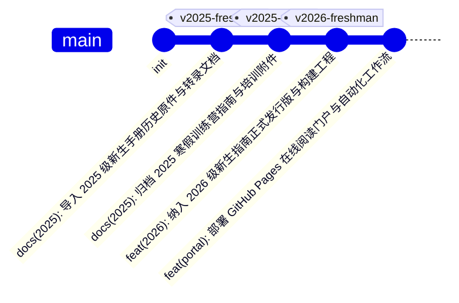

# 湖南大学 Robot 工作坊招新与培训门户 (FreshmanGuide) 架构设计规范

## 1. 项目定位与长期目标

本项目作为湖南大学现代工程训练中心 Robot 工作坊面向未来长期维护的官方招新与技术培训开源档案库。
项目托管于 GitHub 组织 `RobotWorkShop-BigHeroX/FreshmanGuide`，并通过 GitHub Pages 发布在线阅读门户：`https://robotworkshop-bigherox.github.io/FreshmanGuide/`。

核心建设原则：
1. **档案长青，按年沉淀**：以年度（Year）与业务类型（新生招新指南、寒假精英集训）为主轴，历史归档资料永久可追溯，新增年度无缝扩展。
2. **双模交付，职责明确**：在线阅读站点解决即时查阅、检索与跨设备浏览；离线高清 PDF 满足正式下发、打印排版与权威归档。
3. **数据驱动，轻量维护**：依托集中式元数据清单（`catalog.json`），实现导航菜单、文档工具栏与下载链接的单点配置与全站自动化渲染，避免多处硬编码。
4. **安全稳健，极简工程**：采用原生 Web 技术栈与 `DOMPurify` 安全清理，消除重量级前端打包工具链，确保后续历届学生团队零交接负担。

---

## 2. 仓库目录分层规范

```text
FreshmanGuide/
├── .github/
│   └── workflows/
│       └── deploy-pages.yml             # 自动化验证与 GitHub Pages 部署工作流
├── docs/
│   ├── 2026/
│   │   └── freshman/                    # 2026 级新生指南
│   │       ├── 新生指南.md              # 内容唯一事实来源 (SSOT)
│   │       ├── 新生指南.tex             # XeLaTeX 排版源码
│   │       ├── generate_tex.py          # 自动化排版代码生成脚本
│   │       ├── 湖南大学Robot工作坊2026新生指南.pdf # 正式发行版 PDF
│   │       └── assets/                  # 徽标与架构图资源
│   │           ├── RobotWorkShop.jpg
│   │           ├── robocup_subgroups.png
│   │           └── main_competitions.png
│   └── 2025/
│       ├── freshman/                    # 2025 级新生指南
│       │   ├── 2025新生指南.md          # 网页转录阅读版（明确标注转录来源）
│       │   └── ROBOT工作坊2025新生的第一份指南.pdf # 历史官方原件 PDF
│       └── winter-camp/                 # 2025 寒假精英训练营
│           ├── 2025寒假训练营.md        # 培训细则与安排在线阅读版
│           ├── 2025寒假训练营.pdf       # 官方发布通知 PDF
│           └── 2025寒假训练营培训附件.zip # SW 与立创EDA 附件归档包
├── index.html                           # 在线阅读门户单页应用
├── catalog.json                         # 全站文档、版本与资源统一元数据清单
├── pyproject.toml                       # Python 构建工程配置 (基于 uv)
├── uv.lock                              # uv 锁文件
├── README.md                            # 长期门户总主页、版本全景图与构建指引
├── LICENSE                              # MIT 开源授权文件
└── .gitignore                           # Git 忽略配置
```

---

## 3. 内容唯一事实来源 (SSOT) 与生成流转

为杜绝多版本内容漂移，确立如下流转准则：

### 3.1 2026 级新生指南
* **正文唯一事实来源**：`docs/2026/freshman/新生指南.md`。所有的文字修订、结构调整、技术信息增删均首先在 Markdown 中完成。
* **排版衍生**：`docs/2026/freshman/generate_tex.py` 负责将规范文本注入 XeLaTeX 样式模版，生成 `新生指南.tex`。
* **发行衍生**：通过 `xelatex` 编译生成 `湖南大学Robot工作坊2026新生指南.pdf`，作为 Release 归档资产。

### 3.2 2025 级历史资料
* **历史原件定位**：`ROBOT工作坊2025新生的第一份指南.pdf` 与 `2025寒假训练营.pdf` 作为历史原件保留，其内容不做静默篡改。
* **网页阅读版本**：`2025新生指南.md` 与 `2025寒假训练营.md` 标注为“历史转录版”，供网页全文检索与在线查阅，文末提供原件 PDF 直链。

---

## 4. 全局元数据清单 (`catalog.json`) 架构

所有页面导航、工具栏信息、版本号与下载地址均收敛于 `catalog.json`：

```json
{
  "siteTitle": "湖南大学 Robot 工作坊招新与培训门户",
  "orgName": "RobotWorkShop · BigHeroX",
  "defaultDocId": "2026-freshman",
  "categories": [
    {
      "id": "freshman",
      "name": "新生指南",
      "icon": "book",
      "items": [
        {
          "id": "2026-freshman",
          "year": "2026",
          "title": "2026 级新生指南 (具身智能新时代)",
          "badge": "最新正式版",
          "releaseTag": "v2026-freshman",
          "publishDate": "2026-09",
          "author": "李鸿",
          "markdownPath": "docs/2026/freshman/新生指南.md",
          "pdfPath": "docs/2026/freshman/湖南大学Robot工作坊2026新生指南.pdf",
          "pdfSize": "2.6 MB"
        },
        {
          "id": "2025-freshman",
          "year": "2025",
          "title": "2025 级新生的第一份指南",
          "badge": "历史归档",
          "releaseTag": "v2025-freshman",
          "publishDate": "2024-09",
          "author": "江涛、李书淇、乔淼 等",
          "markdownPath": "docs/2025/freshman/2025新生指南.md",
          "pdfPath": "docs/2025/freshman/ROBOT工作坊2025新生的第一份指南.pdf",
          "pdfSize": "630 KB"
        }
      ]
    },
    {
      "id": "winter-camp",
      "name": "寒假训练营",
      "icon": "snowflake",
      "items": [
        {
          "id": "2025-winter",
          "year": "2025",
          "title": "2025 寒假精英训练营指导手册与材料",
          "badge": "集训归档",
          "releaseTag": "v2025-winter",
          "publishDate": "2025-01",
          "author": "Robot 工作坊集训队",
          "markdownPath": "docs/2025/winter-camp/2025寒假训练营.md",
          "pdfPath": "docs/2025/winter-camp/2025寒假训练营.pdf",
          "pdfSize": "866 KB",
          "attachmentPath": "docs/2025/winter-camp/2025寒假训练营培训附件.zip",
          "attachmentSize": "5.8 MB"
        }
      ]
    }
  ]
}
```

---

## 5. Web 阅读站点架构与安全性

### 5.1 视觉与交互规范
* **布局模式**：三栏流式布局（左侧目录树、中间主体阅读区、右侧 TOC 大纲）。
* **紧凑型文档工具栏 (Compact Toolbar)**：
  * 正文起始位置展示紧凑卡片，包含所属年度、版本徽标、更新时间、作者信息、在线 PDF 一键下载按钮及 Release 标签链接。
  * 杜绝使用遮挡正文视线的常驻浮动大卡片，释放移动端与笔记本屏幕的纵向阅读空间。
* **双主题支持**：深色模式（极客深空色 `#0b0f19`）与明亮模式无缝切换，颜色偏好持久化至 `localStorage`。
* **代码与富文本**：高亮语法支持（Highlight.js）、一键复制代码块、GitHub 风格 Alert（Note / Tip / Important / Warning / Caution）。

### 5.2 安全防护与路径兼容
* **HTML 安全清理**：引入 `DOMPurify`（固定版本 3.2.4），在 `marked.parse()` 渲染完成后执行严格清洗，禁止未受信任脚本执行。
* **相对路径解析算法**：
  * 获取当前访问 URL 的目录基准（Base URL），兼容本地直接打开（`file:///`）、本地开发服务器以及 GitHub Pages 项目二级路径（`/FreshmanGuide/`）。
  * 针对 Markdown 内的图片与超链接，编写自动重定位解析器：若文档位于 `docs/2026/freshman/`，正文中的相对图片引用自动补全对应子路径，防止静态部署出现图片破损。

---

## 6. Git 历史与 Release 发布序列（真实提交追溯策略）

为确保版本标签真实对应历史提交，执行三阶段提交与标签挂载：



1. **第 1 次提交**：纳入 `docs/2025/freshman/`，打标签 `v2025-freshman`；创建 Release `2025 级 Robot 工作坊新生指南`，上传对应 PDF。
2. **第 2 次提交**：纳入 `docs/2025/winter-camp/`，打标签 `v2025-winter`；创建 Release `2025 寒假精英训练营指导手册与材料`，上传通知 PDF 与附件 Zip。
3. **第 3 次提交**：纳入 `docs/2026/freshman/` 核心工程，打标签 `v2026-freshman`；创建 Release `2026 级 Robot 工作坊新生指南 (v1.0.0)`，上传正式发行版 PDF。
4. **第 4 次提交**：纳入全站 `index.html`、`catalog.json`、`README.md`、`LICENSE` 及 GitHub Actions 工作流。

---

## 7. 自动化工作流与预发布验证 (`deploy-pages.yml`)

在 GitHub Actions 部署至 GitHub Pages 前，增加轻量级前置检查：
1. **清单数据完整性检查**：运行 Python 脚本验证 `catalog.json`，检查所引用的 `markdownPath` 与 `pdfPath` 文件必须物理存在且非空。
2. **构建部署权限**：声明 `pages: write` 与 `id-token: write`，确保通过官方 Actions 部署。
3. **CDN 降级韧性**：关键样式与结构独立内嵌，第三方库（`marked`, `highlight.js`, `dompurify`）锁定主版本 CDN 并设定网络加载异常降级提示。

---

## 8. 开源协议与第三方资料边界

* **MIT 授权范围**：涵盖仓库中的全部程序代码（`generate_tex.py`、网页前端逻辑、自动化脚本）以及工坊原创的新生指南正文与自制架构图。
* **第三方教程与参考资料声明**：
  * 在 `2025寒假训练营培训附件.zip` 与文档中增加清晰说明：SolidWorks、立创 EDA 等教学讲义版权归原作者或工坊培训讲师所有，仅供团队内部学术交流与技能实训使用，禁止任何商业分发。
